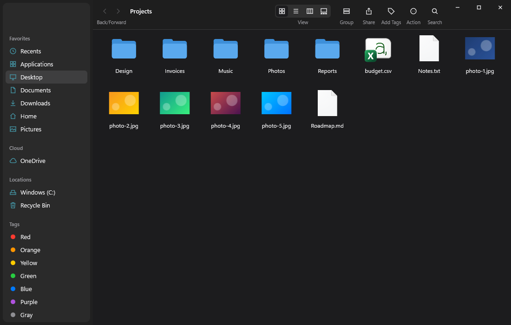
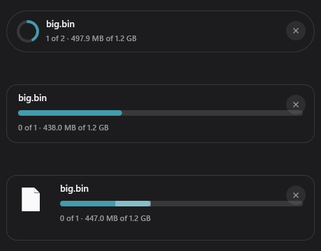
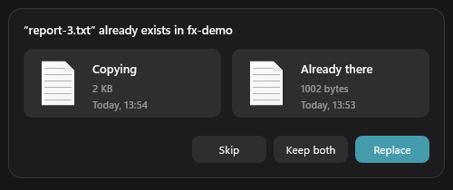

# Files

A fast, small file explorer for Windows, written in Rust. It looks like macOS Finder, works like Windows File Explorer, and copies, moves and deletes files with its own animated progress panels instead of Windows dialogs.



**[Download Files 0.3.0](https://github.com/jassu-Workspace/File-explorer-Rust/releases/latest)** · Windows 10/11, 64-bit · one 0.9 MB exe, no runtime to install

## Why

I got tired of File Explorer feeling slow and cluttered, and of hunting for a file inside one project folder while search crawled the whole drive. Files opens in about 130 ms, sits under 60 MB of memory, uses no CPU when you're not touching it, and searches only the folder you're in and the folders inside it.

It runs fully offline. Nothing is sent anywhere.

## What it does

**Browsing**
- Four views: Icons (extra large, large, medium, small), Details list, Columns and Gallery.
- Sort by name, date modified, date created, size or kind. Group by kind, date, size or first letter.
- Details columns you can show or hide (right-click the header), including Date Created.
- Thumbnails for photos, videos and documents, loaded in the background.
- A sidebar with Favorites, OneDrive, your drives, the Recycle Bin and color tags. Pin any folder to Favorites.
- A breadcrumb path bar and a status line with the item count, selection size and free space.

**Search**
- Type in the search box to find files by name in the current folder and all its subfolders. Results stream in as they're found, and each one shows where it lives.

**Moving files around**
- Copy, cut, paste, drag and drop, Copy to, Move to, rename, new folder, new text document.
- Drag and drop follows Explorer's rules: same drive moves, another drive copies, Ctrl copies, Shift moves. You can drag to and from Explorer, the desktop and other apps.
- Undo and redo (Ctrl+Z / Ctrl+Y) for moves, renames, copies, new items and deletes to the Recycle Bin. Recycled files come back to where they were.

**Windows integration**
- Follows your Explorer settings: single-click or double-click to open, file extensions, hidden and system files. You can override each one in Settings (Ctrl+,).
- Open with, Properties, Copy as path, Open in Terminal, and "Show more options" for the full Windows right-click menu, including Send to and extensions like 7-Zip.
- Light and dark mode, Mica background, accent color and per-monitor DPI scaling.
- Optional "Open in Files" entry when you right-click a folder.

## The transfer animations

Copy, move and delete never open a Windows dialog. Everything happens inside the window.

**Move to Recycle Bin.** A bin pops up in the bottom-right corner, the lid swings open, your files arc into it, and the lid shuts. A toast confirms the move, with an Undo button.


**Progress.** Pick one of three styles in Settings: a slim pill with a ring, a card with a bar, or a small stack of file icons. Each shows the current file, the count, the bytes copied, the speed and the time left. When a copy crosses drives, a strip of particles flows between them at a pace that follows the real speed.



**Name conflicts.** Instead of Windows' dialog, you get the two files side by side with size and date, and Replace, Skip or Keep both. Tick "Do this for the rest" to answer once for every remaining conflict.



**Errors.** When an item fails, its row shakes and says why in plain words, such as "It's open in another app." Retry or Skip it there.


Shift+Delete asks first, because a permanent delete can't be undone.

## Install

1. Download `Files-0.3.0-x64.zip` from [Releases](https://github.com/jassu-Workspace/File-explorer-Rust/releases/latest) and unzip it.
2. Right-click `install.ps1` and choose **Run with PowerShell**, or run:

   ```powershell
   powershell -ExecutionPolicy Bypass -File install.ps1 -Desktop -ContextMenu
   ```

   `-Desktop` adds a desktop icon. `-ContextMenu` adds "Open in Files" to the folder right-click menu. Both are optional.

It installs for your account only, in `%LOCALAPPDATA%\Programs\Files`, with no admin rights needed. It shows up in the Start menu and in Settings > Apps, where you can uninstall it.

Prefer no installer? Download `fexplorer.exe` from the release and run it from anywhere. You can pass a folder or a file: `fexplorer.exe "C:\Projects"` opens that folder, and a file opens its folder with the file selected.

The exe isn't code-signed yet, so the first launch may show "Windows protected your PC". Click **More info**, then **Run anyway**.

## Keyboard shortcuts

| Keys | Action |
|---|---|
| Alt+Left / Alt+Right / Alt+Up | Back / forward / parent folder |
| Backspace | Back |
| Ctrl+L | Type a path |
| Ctrl+F | Search this folder |
| Ctrl+1 / 2 / 3 / 4 | Icons / Details / Columns / Gallery |
| Ctrl+Shift+1 / 2 / 3 / 4 | Extra large / large / medium / small icons |
| Ctrl+Shift+6 | Details |
| Ctrl+Plus / Ctrl+Minus | Bigger / smaller icons |
| Ctrl+A | Select all |
| Ctrl+C / Ctrl+X / Ctrl+V | Copy / cut / paste |
| Ctrl+Shift+C | Copy as path |
| Ctrl+Z / Ctrl+Y | Undo / redo |
| F2 | Rename |
| Delete / Shift+Delete | Recycle Bin / delete permanently |
| Ctrl+Shift+N | New folder |
| Alt+Enter | Properties |
| F5 | Refresh |
| Ctrl+Alt+P | Show or hide the path bar |
| Ctrl+, | Settings |
| Ctrl+N / Ctrl+W | New window / close window |

Type the first letters of a name to jump to it, in any view.

## Performance

Measured on the installed 0.3.0 release on a normal laptop:

| | Result |
|---|---|
| Start-up (warm) | 124–140 ms |
| Memory, 10,000-file folder, idle | 56.9 MB |
| Memory, browsing 60 full-HD photos in Gallery | 84 MB peak |
| CPU while idle | 0 |
| Scrolling | 3–8 ms of each 16 ms frame |
| Recycle Bin animation | 5 ms of each 16 ms frame |

The animation timer only runs while something is moving, so the app goes back to zero CPU as soon as it stops.

## How it's built

Plain Win32 and Rust, using Microsoft's [`windows`](https://crates.io/crates/windows) crate. There's no web view, no UI framework and no other dependencies.

- **Drawing:** Direct2D and DirectWrite on the GPU, with every pixel drawn by the app. Layout works in DIPs, so it stays sharp at any scaling.
- **Folders and search:** read on background threads with `std::fs::read_dir`. The UI thread only receives finished results, so a slow network drive never freezes the window.
- **Thumbnails:** come from the Windows shell (`IShellItemImageFactory`) on a background thread, cached in a size-limited LRU.
- **Copy, move and delete:** run through `IFileOperation` with a progress sink, so they behave exactly like Explorer's (Recycle Bin, long paths, permissions) while the app draws its own UI.
- **Drag and drop:** OLE `IDropTarget` and `SHDoDragDrop`. The right-click menu uses the shell's own `IContextMenu`.

Source map:

```
src/
  app.rs         window, input, state, everything wired together
  draw.rs        Direct2D/DirectWrite wrapper, icons and vector glyphs
  listing.rs     folder reading, sorting, grouping
  search.rs      name search in a folder tree
  transfer.rs    copy/move/delete engine, progress, conflict planning
  motion.rs      animation curves (flight, spring, shake)
  dragdrop.rs    drag and drop
  tools.rs       Properties, Open with, Terminal, Windows menu, Recycle Bin restore
  undo.rs        undo/redo history
  settings.rs    Explorer settings and overrides
  tags.rs        color tags
  views/         toolbar, sidebar, icons, list, columns, gallery, path bar, settings, transfer UI
packaging/       install, uninstall and release scripts
```

## Build from source

You need Rust 1.85 or newer (edition 2024) and the Windows SDK. The SDK provides `rc.exe`, which embeds the icon and version info.

```powershell
cargo build --release              # target\release\fexplorer.exe
cargo test                         # 145 tests
packaging\build-release.ps1        # dist\Files-<version>-x64.zip
```

## Your data

Tags, pinned folders, tag names and per-folder view choices are stored in `%APPDATA%\Files` as two small text files. Uninstalling keeps them unless you run `uninstall.ps1 -RemoveSettings`.

## Known limits

- The Recycle Bin entry opens Windows' own Recycle Bin window. It isn't browsed inside Files.
- There's no separate "This PC" page. The Locations section in the sidebar lists your drives.
- Undo doesn't cover permanent deletes, or copies made with "Keep both", because their new names aren't known.
- Dark right-click menus rely on an undocumented Windows function. If a future Windows removes it, the menus fall back to light.
